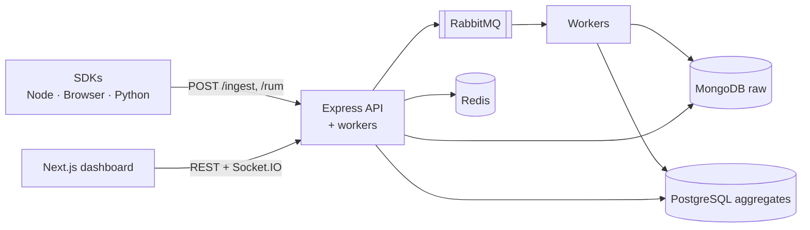

# ApexMonitor

Self-hostable application performance monitoring: API request metrics, browser Real User Monitoring, raw logs, request traces, anomaly insights, alerts, and a live traffic view, with SDKs for Node.js, the browser, and Python.

> **Status: pre-release.** Core flows work locally, but there are known security and correctness issues to fix before production use. See [`docs/known-issues.md`](docs/known-issues.md) and the roadmap in [`plan.md`](plan.md).

## Features

| Area | What it does | Status |
|---|---|---|
| Ingest | Batched HTTP request logs via API key; idempotency keys; tier-based rate limits | Working (tenant check missing: KI-2) |
| RUM | Page views and web vitals (TTFB/FCP/LCP) with device, browser, geo, referrer breakdowns | Server working; browser SDK contract mismatch (KI-10) |
| Metrics | Hourly p50/p95/p99, error rate, Apdex per endpoint | Working; merge math wrong (KI-8) |
| Logs and traces | Searchable raw request logs; per-request detail view | Working (no distributed spans yet) |
| Live traffic | RPS, error rate, top endpoints over WebSocket every 2 s | Working |
| Insights | Z-score latency spike detection | Working (basic) |
| Alerts | Error-rate / p99 rules with webhook delivery | Evaluator only; no API/UI wiring (KI-18) |
| Teams | Projects with owner/developer roles | Working |
| Auth | Email/password, Google and GitHub OAuth | Working |
| Billing | PhonePe checkout → PRO tier | Sandbox only |

## Architecture at a glance



Details: [`docs/architecture/overview.md`](docs/architecture/overview.md).

## Quick start

Requires Node 20+, npm 9+, Docker.

```bash
npm install
docker compose up -d                              # Postgres :9999, Mongo :27018, Redis :6379, RabbitMQ :5672
cp .env.example .env                              # repo root; set JWT_SECRET and ARGON2_PEPPER (32+ chars)
printf "NEXT_PUBLIC_API_URL=http://localhost:3000\nNEXT_PUBLIC_WS_URL=http://localhost:3000\n" > apps/web/.env.local
# apply migrations: see docs/guides/local-development.md#3-database-schema
npm run dev:server                                # http://localhost:3000
npm run dev:web -- -p 3001                        # http://localhost:3001
```

The full walkthrough, including sending your first events, is in [`docs/guides/local-development.md`](docs/guides/local-development.md).

## Repository

```
apps/server     Express API, RabbitMQ workers, Socket.IO
apps/web        Next.js 16 dashboard + marketing site
packages/       @apexmonitor/sdk, @apexmonitor/browser-sdk, apexmonitor-sdk (Python)
scripts/        SQL schema/migrations, CI and smoke scripts
docs/           Architecture, reference, guides, operations, ADRs
```

Full map: [`docs/reference/repository-layout.md`](docs/reference/repository-layout.md).

## Documentation

| | |
|---|---|
| [Docs index](docs/README.md) | Everything below, organised |
| [API reference](docs/reference/api.md) | Endpoints, auth, envelopes, WebSocket events |
| [Configuration](docs/reference/configuration.md) | Environment variables |
| [SDKs](docs/reference/sdks.md) | Usage for Node, browser, Python |
| [Data model](docs/architecture/data-model.md) | Postgres, Mongo, Redis, RabbitMQ |
| [Security model](docs/architecture/security.md) | Auth, keys, tenancy, gaps |
| [Target architecture](docs/architecture/target-architecture.md) | Where the design is heading |
| [Contributing](docs/guides/contributing.md) | Workflow, commit conventions, PR checklist |

## Contributing

Read [`docs/guides/contributing.md`](docs/guides/contributing.md). Use Conventional Commits; keep docs in sync with behaviour in the same PR.
