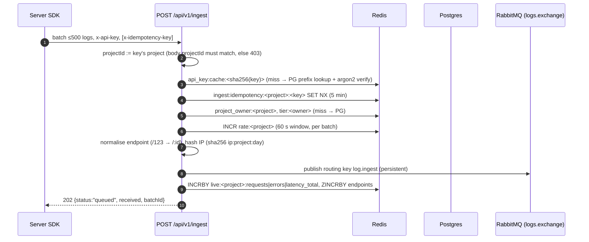
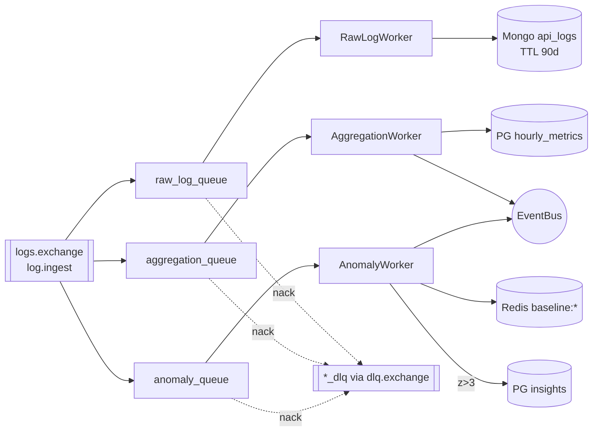
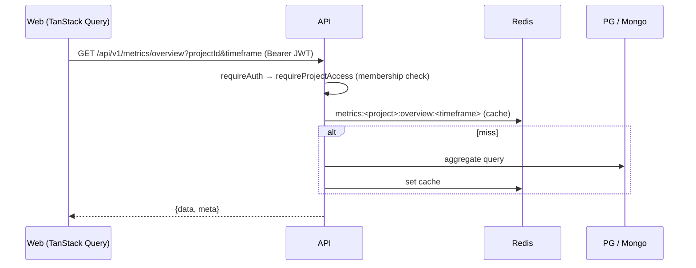
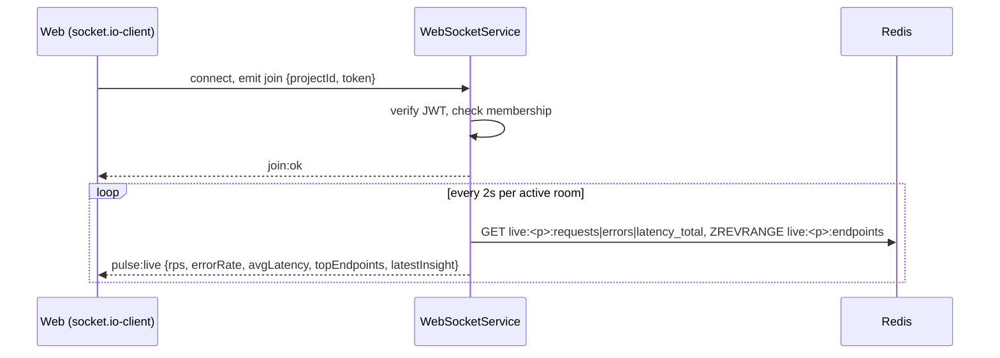
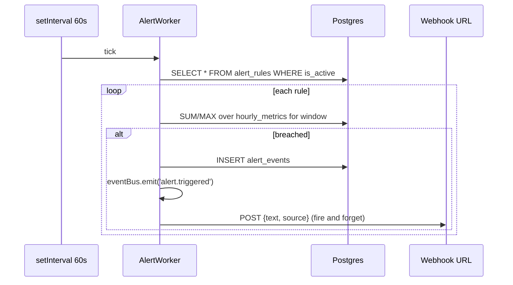

# Data Flows

Sequence-level view of every major flow. Paths are under `apps/server/src/` unless noted.

## 1. Server log ingest



Code: `modules/ingest/ingest.controller.ts`, `ingest.service.ts`, `dto/ingest-batch.dto.ts`.

Fan-out after publish (`log.ingest` is bound to three queues):



The project is always the one bound to the API key; a body `projectId` that differs is rejected with 403. Known problems in this flow: KI-8/9 (aggregation math, local time), KI-16 (no confirms), KI-19 (rate limit per batch).

## 2. Browser RUM ingest

```mermaid
sequenceDiagram
    autonumber
    participant B as Browser SDK
    participant API as POST /api/v1/rum
    participant R as Redis
    participant MQ as RabbitMQ
    participant W as RumWorker
    B->>API: events ≤200, x-rum-key, Origin
    API->>R: rum_key:cache:<sha256(key)> / PG rum_public_keys; origin allow-list checked on every request
    API->>R: INCR rate:rum:<project>:<minute>
    API->>R: rum:idempotency:<project>:<key> SET NX
    API->>API: drop events >24h old or >5 min in future
    API->>API: enrich: browser/os/device from UA, path + referrer normalised,<br/>visitor/session HMAC hashes (daily salt), geo from headers
    API->>MQ: publish rum.ingest {batchId, projectId, events, receivedAt}
    API-->>B: 202
    MQ->>W: rum_queue
    W->>W: insert Mongo rum_raw_events (TTL 7d)
    W->>W: group by project/path/device/browser/country/region/referrer/hour
    W->>R: PFADD rum:hll:* (unique visitors/sessions)
    W->>W: upsert PG hourly_rum_metrics
```

Code: `modules/rum/*`, `workers/rum.worker.ts`. Note KI-10: the published browser SDK doesn't send this schema yet.

## 3. Dashboard queries



| Data | Store | Module |
|---|---|---|
| Metrics overview / latency / operations | PG `hourly_metrics` (+ Redis cache) | `metrics` |
| RUM overview / series / paths / devices / geo / referrers | PG `hourly_rum_metrics` | `rum` |
| Logs | Mongo `api_logs` | `logs` |
| Traces (list, detail) | Mongo `api_logs` | `traces` |
| Insights | PG `insights` | `insights` |

## 4. Live traffic (WebSocket)



## 5. Alert evaluation



The webhook is sent through the SSRF guard in `shared/net/webhook.ts` (https only, public addresses only, no redirects, 5 s timeout). There's no CRUD API, cooldown, resolution, or email delivery yet (KI-18).

## 6. Authentication

**Email/password**

1. `POST /api/v1/users/register` or `POST /api/v1/auth/login`, which validates and hashes/verifies with argon2.
2. Server issues an access JWT (15 min, `tokenType: access`) and a refresh JWT (30 days, `tokenType: refresh`), signed with separate keys (see `shared/auth/tokens.ts`). Every verifier checks `tokenType`, so a refresh token is rejected by `requireAuth` and the websocket join. It sets an httpOnly `refresh_token` cookie and also returns both tokens in the body.
3. Web stores tokens in Redux (persisted) and sends `Authorization: Bearer`.
4. On 401 the web client calls `POST /api/v1/auth/refresh` (cookie or body `refreshToken`), queues concurrent requests, and replays them.

**OAuth (Google/GitHub)**

1. `GET /api/v1/auth/oauth/:provider/start?mode=login|register` redirects to the provider.
2. The provider calls back `GET /api/v1/auth/oauth/:provider/callback`. The server verifies the signed `state`, exchanges the provider code, and upserts the user.
3. The server stores the new token pair in Redis under a random single-use code (`oauth:login_code:<sha256(code)>`, 60 s) and redirects to `${FRONTEND_URL}/oauth/callback?code=…&provider=…`. Tokens never appear in a URL.
4. The web callback page calls `POST /api/v1/auth/oauth/exchange {code}`, which returns the tokens once (Redis `GETDEL`) and sets the refresh cookie. A reused or expired code gets 401 and the page sends the user back to `/login`.

## 7. Key issuance

1. Owner calls `POST /api/v1/keys` (or legacy `POST /api/v1/auth/keys`, `/auth/rum-keys`) with `projectId`.
2. Server generates `proj_<base64url(32 bytes)>`, stores `key_prefix` (first 10 chars) + argon2id(key + `ARGON2_PEPPER`), and returns the raw key once.
3. Validation: prefix lookup → argon2 verify → cache project id in Redis 5 min.

## 8. Billing (PhonePe)

1. `POST /api/v1/billing/checkout` (JWT) builds a PhonePe pay request (₹2,999), signs it with salt key, and returns the redirect URL.
2. PhonePe calls `POST /api/v1/billing/webhook/phonepe` with a base64 payload + `X-VERIFY`. On a valid signature and `PAYMENT_SUCCESS`, the server upserts `subscriptions` → `PRO` and deletes `tier:<userId>` from Redis.
3. The ingest rate limit for projects owned by that user becomes 600k per window.
