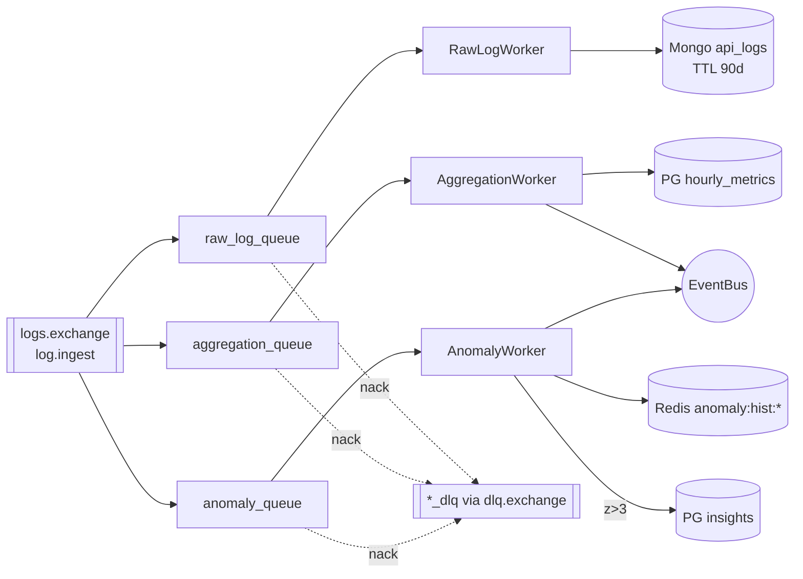
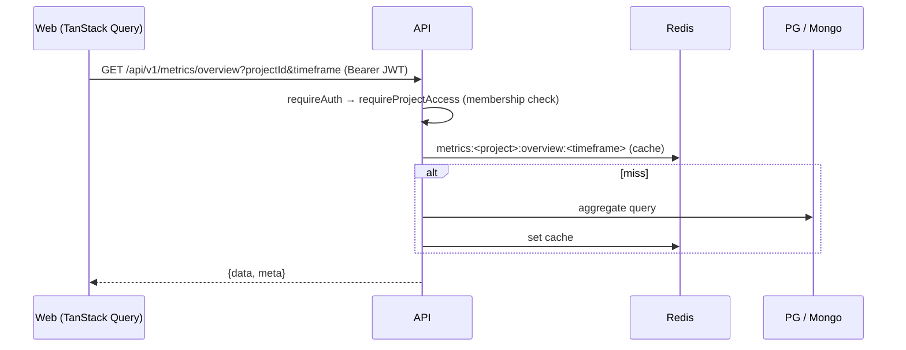
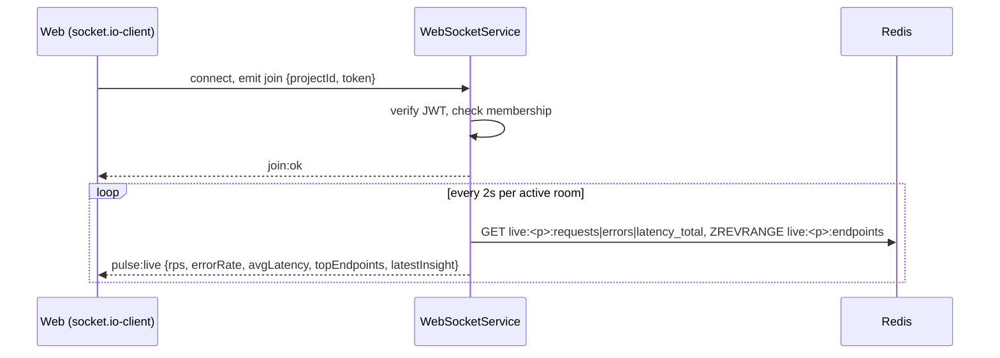
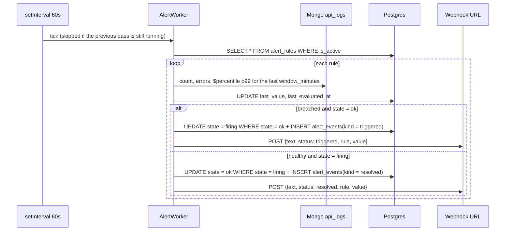

# Data Flows

Sequence-level view of every major flow. Paths are under `apps/server/src/` unless noted.

## 1. Server log ingest

```mermaid
sequenceDiagram
    autonumber
    participant SDK as Server SDK
    participant API as POST /api/v1/ingest
    participant R as Redis
    participant PG as Postgres
    participant MQ as RabbitMQ (logs.exchange)
    SDK->>API: batch ≤500 logs, x-api-key, [x-idempotency-key]
    API->>API: projectId := key's project (body projectId must match, else 403)
    API->>R: api_key:cache:<sha256(key)>  (miss → PG lookup by HMAC of the key + argon2 verify)
    API->>R: ingest:idempotency:<project>:<key> SET NX (5 min)
    API->>R: project_owner:<project>, tier:<owner> (miss → PG)
    API->>R: rate limit: Lua on rate:ingest:<project>:<minute> (events, sliding 60 s window)
    API->>API: normalise endpoint (/123 → /:id), hash IP (sha256 ip:project:day)
    API->>MQ: publish routing key log.ingest (persistent)
    API->>R: INCRBY live:<project>:requests|errors|latency_total, ZINCRBY endpoints
    API-->>SDK: 202 {status:"queued", received, batchId} (only after the broker confirms; else 503 + Retry-After)
```

Code: `modules/ingest/ingest.controller.ts`, `ingest.service.ts`, `dto/ingest-batch.dto.ts`.

Fan-out after publish (`log.ingest` is bound to three queues):



The project is always the one bound to the API key; a body `projectId` that differs is rejected with 403. The rate limit counts events (a 500-log batch costs 500) over a sliding 60 s window; an over-limit batch gets `429` with `Retry-After` and uses no budget.

## 2. Browser RUM ingest

```mermaid
sequenceDiagram
    autonumber
    participant B as Browser SDK
    participant API as POST /api/v1/rum
    participant R as Redis
    participant MQ as RabbitMQ
    participant W as RumWorker
    B->>API: events ≤200, x-rum-key, Origin
    API->>R: rum_key:cache:<sha256(key)> / PG rum_public_keys; origin allow-list checked on every request
    API->>R: INCR rate:rum:<project>:<minute>
    API->>R: rum:idempotency:<project>:<key> SET NX
    API->>API: drop events >24h old or >5 min in future
    API->>API: enrich: browser/os/device from UA, path + referrer normalised,<br/>visitor/session HMAC hashes (daily salt), geo from headers
    API->>MQ: publish rum.ingest {batchId, projectId, events, receivedAt}
    API-->>B: 202
    MQ->>W: rum_queue
    W->>W: insert Mongo rum_raw_events (TTL 7d)
    W->>W: group by project/path/device/browser/country/region/referrer/hour
    W->>R: PFADD rum:hll:* (unique visitors/sessions)
    W->>W: upsert PG hourly_rum_metrics
```

Code: `modules/rum/*`, `workers/rum.worker.ts`. `@apexmonitor/browser-sdk` sends this schema; its tests validate batches against the server's Zod schema.

## 3. Dashboard queries



| Data | Store | Module |
|---|---|---|
| Metrics overview / latency / operations | PG `hourly_metrics` (+ Redis cache) | `metrics` |
| RUM overview / series / paths / devices / geo / referrers | PG `hourly_rum_metrics` | `rum` |
| Logs | Mongo `api_logs` | `logs` |
| Traces (list, detail) | Mongo `api_logs` | `traces` |
| Insights | PG `insights` | `insights` |

## 4. Live traffic (WebSocket)



## 5. Alert evaluation

Rules are managed through `/api/v1/alerts/rules` (see [api.md](../reference/api.md#alerts)) and evaluated by `workers/alert.worker.ts` once a minute.



- Only transitions notify. A rule that stays breached is not re-sent every minute; it notifies again only after it has resolved.
- The transition and its event row are one SQL statement that changes the rule only if it is still in the old state, so two evaluators (or replicas) can't both notify.
- No traffic in the window never breaches, and resolves a firing rule.
- Editing a rule's condition, threshold, window or endpoint, or disabling it, resets it to `ok`.
- `eventBus.emit('alert.triggered')` (severity `critical` or `info`) updates live dashboards.
- Webhooks go through the SSRF guard in `shared/net/webhook.ts` (https only, public addresses only, no redirects, 5 s timeout).
- `notify_email` is stored, but no email is sent yet (notification channels are plan Phase 4b).

## 6. Authentication

**Email/password**

1. `POST /api/v1/users/register` or `POST /api/v1/auth/login`, which validates and hashes/verifies with argon2.
2. Server issues an access JWT (15 min, `tokenType: access`) and a refresh JWT (30 days, `tokenType: refresh`), signed with separate keys (see `shared/auth/tokens.ts`). Every verifier checks `tokenType`, so a refresh token is rejected by `requireAuth` and the websocket join. It sets an httpOnly `refresh_token` cookie and also returns both tokens in the body.
3. Web stores tokens in Redux (persisted) and sends `Authorization: Bearer`.
4. On 401 the web client calls `POST /api/v1/auth/refresh` (cookie or body `refreshToken`), queues concurrent requests, and replays them.

**OAuth (Google/GitHub)**

1. `GET /api/v1/auth/oauth/:provider/start?mode=login|register` redirects to the provider.
2. The provider calls back `GET /api/v1/auth/oauth/:provider/callback`. The server verifies the signed `state`, exchanges the provider code, and upserts the user.
3. The server stores the new token pair in Redis under a random single-use code (`oauth:login_code:<sha256(code)>`, 60 s) and redirects to `${FRONTEND_URL}/oauth/callback?code=…&provider=…`. Tokens never appear in a URL.
4. The web callback page calls `POST /api/v1/auth/oauth/exchange {code}`, which returns the tokens once (Redis `GETDEL`) and sets the refresh cookie. A reused or expired code gets 401 and the page sends the user back to `/login`.

## 7. Key issuance

1. Owner calls `POST /api/v1/keys` (or legacy `POST /api/v1/auth/keys`, `/auth/rum-keys`) with `projectId`.
2. Server generates `proj_<base64url(32 bytes)>`, stores `key_prefix` (first 10 chars) + argon2id(key + `ARGON2_PEPPER`), and returns the raw key once.
3. Validation: prefix lookup → argon2 verify → cache project id in Redis 5 min.

## 8. Billing (PhonePe)

1. `POST /api/v1/billing/checkout` (JWT) creates a random `merchantTransactionId`, records it in `billing_checkouts` (user, plan, amount, `PENDING`), builds a PhonePe pay request (₹2,999) signed with the salt key, and returns the redirect URL. PhonePe gets an opaque `merchantUserId` (hash of the user id), never the user id itself.
2. PhonePe calls `POST /api/v1/billing/webhook/phonepe` with a base64 payload + `X-VERIFY`. On a valid signature and `PAYMENT_SUCCESS`, one SQL statement marks the checkout `SUCCESS` (only if it is still `PENDING` and the paid amount matches) and upserts `subscriptions` → `PRO` for the user stored on that checkout. Then `tier:<userId>` is deleted from Redis. Replays and unknown or wrong-amount transactions change nothing and still get 200. Failure codes mark the checkout `FAILED`; `PAYMENT_PENDING` is ignored.
3. The ingest rate limit for projects owned by that user becomes 600k per window.
