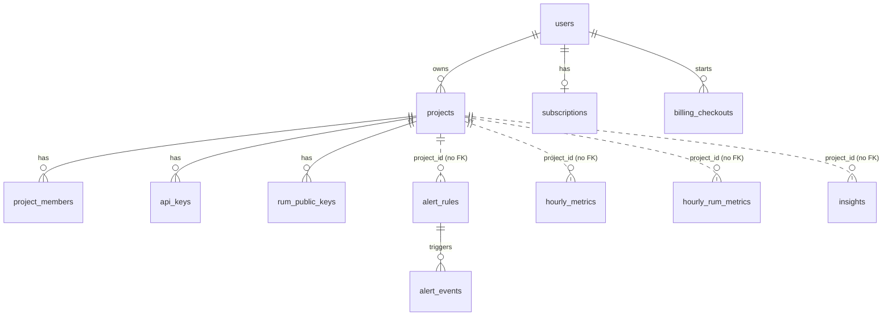

# Data Model

Source of truth: `scripts/migrations/*.sql` (applied in order, tracked in `schema_migrations`), Mongoose schemas in `apps/server/src/modules/{logs,rum}/*.schema.ts`, Redis key usage across `apps/server/src`, topology in `apps/server/src/infrastructure/rabbitmq.ts`.

## PostgreSQL

### Identity and tenancy

| Table | Key columns | Notes |
|---|---|---|
| `users` | `id` PK, `email` unique, `password_hash`, `name`, `company`, `job_title`, `timezone` | v2 + v4 migrations |
| `projects` | `id` PK (`proj_…`), `name`, `owner_user_id` → users (RESTRICT), `plan`, `rate_limit_rpm`, `log_retention_days` (90) | `plan`, `rate_limit_rpm`, `log_retention_days` aren't read by code yet |
| `project_members` | `project_id` → projects (CASCADE), `user_id`, `role` (`owner`/`developer`, CHECK constraint since v9), unique(project,user) | `user_id` has no FK |
| `subscriptions` | `user_id` PK → users (CASCADE), `plan_tier` (`FREE`/`PRO`), `last_tx_id`, `payment_status` | Per user, not per org |
| `billing_checkouts` | `merchant_transaction_id` PK, `user_id` → users (CASCADE), `plan_tier`, `amount_paise`, `status` (`PENDING`/`SUCCESS`/`FAILED`), `gateway_code`, `completed_at` | v5. The payment webhook finds the user here |
| `schema_migrations` | `version` PK, `name`, `checksum` (sha256 of the file), `applied_at` | Written by the migration runner |
| `audit_logs` | `actor_user_id`, `project_id`, `action`, `resource_type`, `resource_id`, `metadata` jsonb, `ip_address`, `user_agent` | Written by `shared/services/audit-log.service.ts` |

### Credentials

| Table | Key columns | Notes |
|---|---|---|
| `api_keys` | `project_id`, `key_prefix` (10 chars, display only, not unique), `key_lookup` (HMAC-SHA256 of the key, unique; v6), `key_hash` (argon2id, unique), `label`, `last_used_at`, `revoked_at` | Ingest keys `pk_live_…` / legacy `proj_…`. Found by `key_lookup`; rows created before v6 are found by prefix and get `key_lookup` on first use |
| `rum_public_keys` | as above + `allowed_origins text[]` | Browser write keys |

### Telemetry aggregates

| Table | Grain (unique key) | Measures |
|---|---|---|
| `hourly_metrics` | project, endpoint, method, hour_bucket (UTC hour) | request_count, error_count, satisfied/tolerating/frustrated counts; mergeable latency stats (v7): `latency_sum_ms`, `latency_min_ms`, `latency_max_ms`, `latency_hist` (log-scale histogram, bucket k = (1.1^(k-1), 1.1^k] ms); derived `avg_ms` (exact) and `p50/p95/p99_ms` (from the histogram, within ~5%, clamped to min/max). `rps_peak` is unused (always 0) |
| `hourly_rum_metrics` | project, path, device_type, browser_name, country_code, region_code, referrer_source, hour_bucket | page_views, unique_visitors, unique_sessions, avg + sample counts for TTFB/FCP/LCP |
| view `hourly_apdex` | from hourly_metrics | `(satisfied + tolerating/2) / total` |

To read latency across several rows (hours, endpoints), merge, don't average: `SUM(latency_sum_ms) / SUM(request_count)` for the mean and `apex_hist_percentile(apex_hist_sum(latency_hist), q, MIN(latency_min_ms), MAX(latency_max_ms))` for percentiles. `shared/utils/latency-sql.ts` has both as SQL fragments; the SQL functions are defined in `scripts/migrations/0008_latency_histograms.sql`.

### Alerting and insights

| Table | Key columns |
|---|---|
| `alert_rules` | `project_id`, `name`, `condition_type` (`error_rate_high`, `latency_p99_high`), `endpoint_filter`, `threshold` (% or ms), `window_minutes`, `notify_email` (not sent yet), `notify_webhook`, `is_active`; state (v8): `state` (`ok`/`firing`), `last_value`, `last_evaluated_at`, `last_triggered_at`, `last_resolved_at`, `updated_at` |
| `alert_events` | `alert_rule_id` → alert_rules (CASCADE), `project_id`, `kind` (`triggered`/`resolved`, v8), `message`, `value`, `metadata`, `triggered_at` (time of the event) |
| `insights` | `project_id`, `endpoint`, `severity`, `type` (`latency_spike`, …), `message`, `metadata`, `is_read` |

## MongoDB

| Collection | Model | Fields | Indexes / TTL |
|---|---|---|---|
| `api_logs` | `ApiLog` (`modules/logs/logs.schema.ts`) | reqId (unique), projectId, method, endpoint, statusCode, latencyMs, ip (hashed), userAgent, region (`XX`), timestamp, sdkVersion, tags | (projectId, timestamp), (projectId, endpoint, timestamp), (projectId, statusCode, timestamp); **TTL 90 days** on timestamp |
| `rum_raw_events` | `RumRawEvent` (`modules/rum/rum.schema.ts`) | eventId (unique), projectId, type, path, referrerSource, sessionHash, visitorHash, ttfb/fcp/lcpMs, browserName, osName, deviceType, countryCode, regionCode, timestamp, sdkVersion, ingestedAt | (projectId, timestamp), (projectId, path, timestamp); **TTL 7 days** on ingestedAt |

## Redis keys

| Pattern | Type | TTL | Writer → Reader |
|---|---|---|---|
| `oauth:login_code:<sha256(code)>` | JSON `{accessToken, refreshToken}`; read once with `GETDEL` | 60 s | auth.service (OAuth callback → exchange) |
| `api_key:cache:<sha256(key)>` | JSON `{projectId}` | 300 s | auth/key-cache |
| `api_key:ref:<keyId>` | sha256 of the key (lets revoke find the cache entry) | 300 s | auth/key-cache |
| `api_key:revoked:<keyId>` | `1` tombstone; blocks re-caching after revoke | 600 s | auth/key-cache |
| `rum_key:cache:<sha256(key)>` | JSON `{projectId, allowedOrigins}` | 300 s | auth/key-cache |
| `rum_key:ref:<keyId>`, `rum_key:revoked:<keyId>` | as for API keys | 300 / 600 s | auth/key-cache |
| `project_owner:<projectId>` | string | 3600 s | ingest.service |
| `tier:<userId>` | string | 3600 s | ingest.service; deleted by billing webhook |
| `alerts:evaluation-pass` | instance id of the replica running this minute's alert pass | 55 s | AlertWorker |
| pub/sub `apexmonitor:events` | JSON `{origin, event, payload}` relayed between replicas | n/a | events/event-bus |
| `rate:ingest:<projectId>:<minute index>` | events counted in that minute (sliding window uses this + the previous minute) | 120 s | shared/rate-limit/sliding-window |
| `rate:rum:<projectId>:<minute index>` | same, for RUM events | 120 s | shared/rate-limit/sliding-window |
| `ingest:idempotency:<projectId>:<key>` | JSON | 300 s | ingest.service |
| `rum:idempotency:<projectId>:<key>` | string (batchId) | 300 s | rum.service |
| `live:<projectId>:requests` / `:errors` / `:latency_total` | counter / float | 5 s | ingest.service → websocket |
| `live:<projectId>:endpoints` | sorted set | 8 s | ingest.service → websocket |
| `baseline:<projectId>:<endpoint>:p99` | list (≤20) | 3600 s | anomaly.worker |
| `rum:hll:*` | HyperLogLog | n/a | rum.worker |
| `metrics:<projectId>:<view>:…` | JSON | short | metrics.service (query cache) |

Redis is started with `maxmemory 256mb` and `allkeys-lru` in compose, so **any** key, including rate limits and idempotency locks, can be evicted under memory pressure.

## RabbitMQ topology

| Exchange | Type | Durable |
|---|---|---|
| `logs.exchange` | direct | yes |
| `dlq.exchange` | direct | yes |
| `ws.fanout` | fanout | no (declared, unused) |

| Queue | Bound to (routing key) | DLQ | Message TTL |
|---|---|---|---|
| `raw_log_queue` | logs.exchange (`log.ingest`) | `raw_log_dlq` | 24 h |
| `aggregation_queue` | logs.exchange (`log.ingest`) | `aggregation_dlq` | 24 h |
| `anomaly_queue` | logs.exchange (`log.ingest`) | `anomaly_dlq` | 24 h |
| `rum_queue` | logs.exchange (`rum.ingest`) | `rum_dlq` | 24 h |

Each `<name>_dlq` queue is bound to `dlq.exchange` with routing key `<name>_dlq`. A message lands there when a worker rejects it (`nack` without requeue) or when it sits in its worker queue for more than 24 h. Nothing consumes the DLQs; their depth is reported by `/ready` and `/metrics/system`. Replay is manual (see `docs/operations/runbooks.md`).

### Message shapes

- `log.ingest`: JSON array of normalised logs `{reqId, projectId, method, endpoint, statusCode, latencyMs, ip, userAgent, region, timestamp, sdkVersion, tags}`; headers `projectId`, `sdkVersion`, `idempotencyKey`; `messageId = correlationId = batchId`.
- `rum.ingest`: `{batchId, projectId, events: RumEnrichedEvent[], receivedAt}`.

Neither message carries a schema version.

## Retention summary

| Data | Retention | Mechanism |
|---|---|---|
| Raw request logs | 90 days | Mongo TTL index (not per plan) |
| Raw RUM events | 7 days | Mongo TTL index |
| Hourly aggregates, insights, alert events, audit logs | forever | none |
