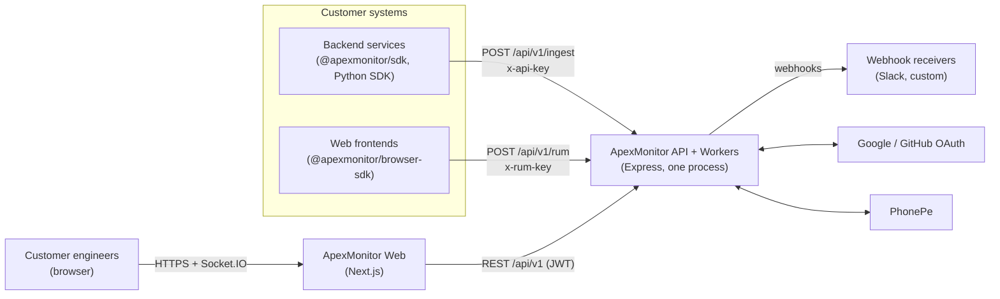
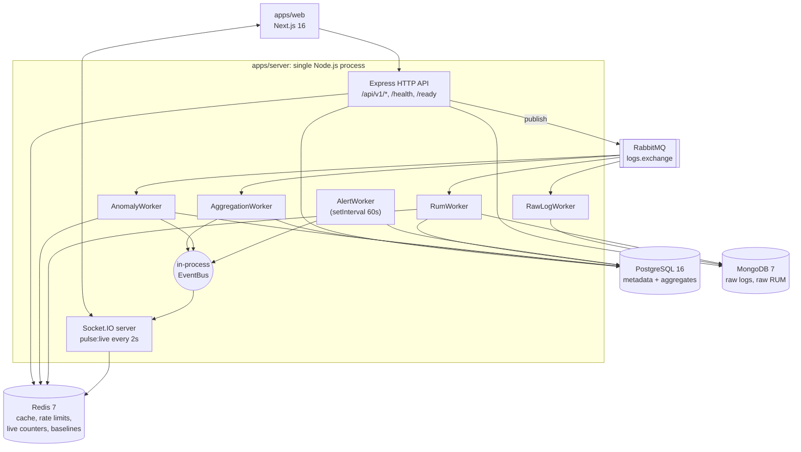

# Architecture Overview

ApexMonitor collects telemetry from customer applications (server request logs and browser RUM events), processes it asynchronously, and serves dashboards, live traffic, anomaly insights, and alerts.

> Describes the system **as built** at commit `debac85`. For the planned design see [target-architecture.md](target-architecture.md). Defects are in [../known-issues.md](../known-issues.md).

## System context

## Containers (runtime processes)

Key facts:

- **One backend process** runs the HTTP API, Socket.IO, four RabbitMQ consumers, and the alert loop (`apps/server/src/bootstrap.ts`). They can't be scaled separately yet.
- **Async-first ingest:** ingest endpoints validate, rate-limit, normalise, publish to RabbitMQ, and return `202`. Persistence and aggregation happen in workers.
- **Two read paths:** dashboards query aggregates in Postgres (metrics, RUM) or raw documents in Mongo (logs, "traces"); live traffic reads short-TTL counters from Redis.
- **Event bus** is a typed Node `EventEmitter`, so it only works because everything shares one process.

## Components

| Component | Location | Responsibility |
|---|---|---|
| API server | `apps/server/src/app.ts`, `modules/*` | Auth, key management, ingest endpoints, query endpoints, billing |
| Workers | `apps/server/src/workers/*` | Persist raw data, aggregate, detect anomalies, evaluate alerts |
| Realtime | `apps/server/src/modules/websocket` | Authenticated project rooms, 2 s live pulse |
| Dashboard | `apps/web` | Marketing, auth, and dashboard UI |
| TS SDK | `packages/sdk` | Typed client for all API domains; transport with retries/idempotency |
| Browser SDK | `packages/browser-sdk` | Queues and flushes RUM events (built on TS SDK) |
| Python SDK | `packages/python-sdk` | `requests`-based client for ingest and read APIs |
| Schema | `scripts/*.sql` | Postgres DDL + migrations |
| Local infra | `docker-compose.yml` | Mongo, Postgres, Redis, RabbitMQ |

## Tech stack

| Layer | Choice |
|---|---|
| Language | TypeScript (Node 20), Python ≥ 3.9 for the Python SDK |
| HTTP | Express 5, helmet, cors, compression, pino-http |
| Validation | Zod 4 |
| Auth | jsonwebtoken (HS256), argon2id for keys and passwords |
| Queue | RabbitMQ 3.13 via amqplib |
| Stores | PostgreSQL 16 (`pg`), MongoDB 7 (mongoose), Redis 7 (ioredis) |
| Realtime | Socket.IO 4 |
| Web | Next.js 16 (App Router), React 19, Tailwind 4, Redux Toolkit + redux-persist, TanStack Query, Recharts, React-Leaflet |
| CI | GitHub Actions: build, migration validation, SDK conformance, SDK release |

## Quality attributes (current)

| Attribute | Status |
|---|---|
| Tenant isolation | Enforced on dashboard reads; **not** on log ingest (KI-2) |
| Durability | Queues and messages durable; publisher confirms missing (KI-16) |
| Correctness | Hourly percentiles/averages wrong when merged (KI-8) |
| Scalability | Single process; in-process event bus; interval-based alert loop (KI-20) |
| Observability of itself | `/health`, `/ready`, `/metrics/system`, pino request logs |
| Testability | No tests; module-level singletons (KI-28) |

## Related
- [backend.md](backend.md) · [data-flow.md](data-flow.md) · [data-model.md](data-model.md) · [frontend.md](frontend.md) · [security.md](security.md)
