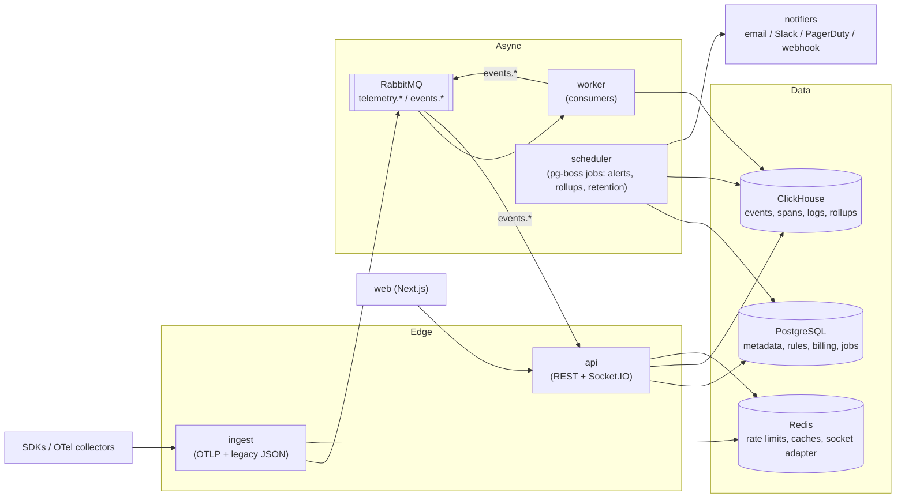

# Target Architecture

> **Status: Proposed.** This is where the system is heading, not what exists. Individual decisions are recorded as ADRs in [`../adr/`](../adr/README.md). Sequencing is in [`../../plan.md`](../../plan.md).

## Goals

1. **Isolation by construction:** tenant identity comes only from credentials; cross-tenant access is impossible through any API.
2. **No silent data loss:** every accepted event is persisted at least once and counted exactly once.
3. **Correct numbers:** percentiles and averages are mergeable across time and replicas.
4. **Independent scaling:** ingest, query API, workers, and realtime scale separately.
5. **Cheap to self-host:** few stateful dependencies, one-command install.
6. **Standards-first:** accept OpenTelemetry so customers aren't locked into our SDKs.

## Logical view



Changes from today:

| Today | Target | Why |
|---|---|---|
| One process (API + workers + loops) | `apps/api`, `apps/ingest`, `apps/worker` (+ scheduler inside worker) | Scale and deploy independently |
| Mongo raw store + PG aggregates | ClickHouse for all telemetry; PG metadata only; drop Mongo | One fast analytical store, fewer services to self-host |
| Custom JSON ingest | OTLP/HTTP primary, legacy JSON kept | Every language and framework supported |
| `EventEmitter` bus | RabbitMQ `events` topic exchange + Socket.IO Redis adapter | Works across processes and replicas |
| `setInterval` alert loop | pg-boss scheduled jobs with singleton keys | Exactly one evaluation per rule per tick |
| Percentile via `GREATEST()` | Sketches / ClickHouse aggregate states | Correct merged percentiles |
| Plain publish | Confirm channel + idempotent consumers | At-least-once delivery, exactly-once counting |
| Raw SQL files | Migration runner, versioned | Reproducible schema |
| Per-user billing | Org-level plans, metering, quotas | How B2B buyers purchase |

## Repository structure (target)

```
apps/
  api/        HTTP + realtime; composition root src/container.ts
  ingest/     Ingest edge (can start inside api; split when traffic warrants)
  worker/     Queue consumers + scheduled jobs
  web/
packages/
  contracts/  Zod schemas, types, endpoint paths, message + event schemas (versioned)
  core/       Domain services + repositories, grouped by domain
  platform/   Config, logger, DB/cache/broker client factories
  db/         Migrations, runner, seeds
  tooling/    tsconfig.base, eslint, prettier
sdks/
  node/  browser/  python/
infra/
  compose/  docker/  helm/
tests/
  e2e/  load/
docs/
```

Domains inside `packages/core`: `identity`, `orgs`, `projects`, `keys`, `telemetry`, `metrics`, `alerting`, `insights`, `billing`, `audit`. Each exposes services with dependencies injected through constructors; apps wire them in a composition root.

## Tenancy model

```
organization ─┬─ members (owner | admin | member | viewer)
              ├─ subscription / plan / usage
              └─ projects ─┬─ environments (prod, staging, …)
                           ├─ keys (ingest | rum | read), scoped
                           └─ alert rules, dashboards, SLOs
```

- Tenant columns (`org_id`, `project_id`) on every telemetry row; ClickHouse primary key starts with `project_id`.
- Credentials resolve to `(org_id, project_id, env, scopes)`; handlers receive that context object and never read tenant IDs from input.
- Defence in depth: Postgres row-level security keyed on a session variable for metadata tables.

## Ingest pipeline

1. Authenticate key → tenant context (cached by key hash; revocation publishes cache-bust).
2. Enforce plan quota (sliding window/GCRA in Redis, per events not batches) → `429` with `Retry-After`.
3. Validate + normalise to internal schema (`schemaVersion`), cap cardinality.
4. Publish on a confirm channel; on broker backpressure return `503`.
5. Respond `202` only after confirm.
6. Workers batch-insert into ClickHouse with dedupe keys (`event_id`); rollups via materialised views.

## Query path

- REST endpoints read ClickHouse rollups (1 m / 1 h / 1 d) chosen by time range; raw for drill-down.
- Cursor pagination; per-tenant query timeouts and row limits.
- Short Redis cache for dashboard tiles.

## Alerting

- Rules evaluated by scheduled job every 30–60 s against 1-minute rollups.
- State machine: `ok → pending (for: N) → firing → resolved`, with dedupe keys, cooldown, silences.
- Notifications fan out through a notifier queue with retries; webhooks are SSRF-guarded and HMAC-signed.

## Realtime

- Workers publish `events.live.<projectId>` and `events.alert.<projectId>`; the API subscribes and forwards to Socket.IO rooms; the Redis adapter syncs rooms across API replicas.

## Operability

- OpenTelemetry instrumentation of all apps; Prometheus metrics (queue depth, consumer lag, DLQ size, ingest latency, insert latency).
- `/health` (liveness) and `/ready` (dependency checks) per app; `/metrics` behind auth or internal network.
- Graceful shutdown: stop intake → drain consumers → flush buffers → close clients.
- Helm chart with HPA (CPU for api/ingest, queue depth for worker).

## AI layer

Built **on top of** deterministic detection, never instead of it.

1. **Detection:** seasonality-aware baselines (per endpoint, hour-of-week), multivariate signals (latency, errors, throughput, RUM vitals).
2. **Correlation:** group concurrent anomalies across services/endpoints; link to deploy markers.
3. **Explanation:** LLM-generated incident summaries grounded in the evidence (queries, top traces, logs) with citations.
4. **Assist:** natural-language → query, alert-tuning suggestions.

Guardrails: tenant-isolated context, confidence thresholds with rule-based fallback, cost controls (sampling, batching), audit of AI outputs.

## Decisions index

| ADR | Topic | Status |
|---|---|---|
| [0001](../adr/0001-record-architecture-decisions.md) | Record decisions as ADRs | Accepted |
| [0002](../adr/0002-tenant-identity-from-credentials.md) | Tenant identity only from credentials | Proposed |
| [0003](../adr/0003-split-api-and-worker.md) | Split API and worker processes | Proposed |
| [0004](../adr/0004-telemetry-storage.md) | ClickHouse for telemetry | Proposed |
| [0005](../adr/0005-otlp-ingest.md) | OTLP as primary ingest format | Proposed |
